<div align="center">

# LORE-KV: Monte Carlo Estimation for KV-Cache Eviction

**L**ookahead **O**utput-perturbation with **R**eliability-weighted **E**nsembles for **K**ey-**V**alue caches

*Most KV-cache eviction methods ask which memory looked important while reading the prompt.
LORE-KV asks which memory will matter while answering.*

<p>
  
  
  
  
  
</p>

🧭 [Method](#-method) · 📊 [Results](#-results) · ⚙️ [Installation](#%EF%B8%8F-installation) · 🚀 [Quick start](#-quick-start) · 🔁 [Reproducing the paper](#-reproducing-the-paper) · 📚 [Citation](#-citation)

</div>

<p align="center">
  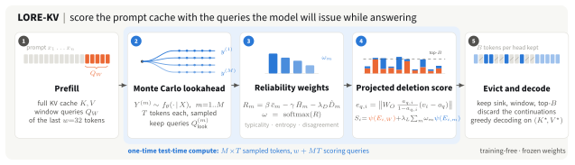
</p>

LORE-KV is a **training-free** KV-cache eviction method for long-context LLM inference. Before the
prompt's cache is compressed to a fixed budget, it samples a few short continuations from the frozen
model itself, uses their query states as Monte Carlo samples of the queries the model will issue while
answering, and keeps the tokens whose deletion would most change the attention output under those
queries. The continuations are then discarded; decoding runs on the compressed cache only.

## ✨ Highlights

- 🔭 **Future-query reference.** Prompt-side methods (SnapKV, Ada-KV, CriticalKV, AnDPro) rank tokens with the
  queries of the last prompt tokens, which can differ from the queries used during generation. LORE-KV
  scores against sampled answer-time queries.
- 🧊 **No auxiliary model, no training.** The lookahead uses the target model; its weights are untouched.
- 🎯 **Output-aware scoring.** Tokens are ranked by the projected leave-one-out change of the attention
  output, not by attention mass alone.
- ⚖️ **Matched evaluation.** All methods share budgets, observation window, chunk size and selector, on six
  dense and hybrid-attention backbones.

At $B=128$, LORE-KV raises the LongBench average on Qwen2.5-14B from 45.49 to 48.24 and the 16K RULER
average on Mistral-7B from 45.20 to 51.05, at 1.46-2.77x AnDPro's per-sample time. Gains are largest under
tight budgets and shrink as the budget grows.

## 🧭 Method

<p align="center">
  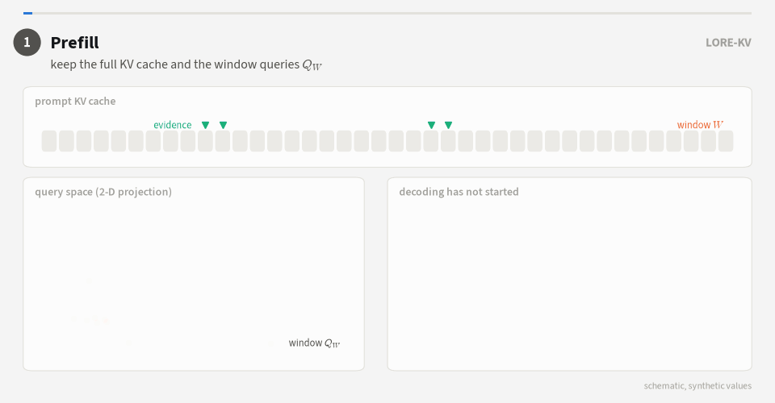
</p>

**The problem.** Eviction happens once, after prefill, before any answer token exists. Prompt-side methods
therefore score tokens with the queries of the prompt's last $w$ tokens, $Q_W$. When these differ from the
queries the model issues while answering, tokens that will be needed are evicted. The gain of LORE-KV
grows with this prompt-to-future mismatch (paper Sec. 4.5).

**The estimator.** Given a prompt $X$ and a frozen model $f_\theta$, LORE-KV (Algorithm 1):

1. **Prefills** the prompt, keeping the full cache $K, V$ and the window queries $Q_W$.
2. **Samples** $M$ continuations of $T$ tokens, $Y^{(m)} \sim f_\theta(\cdot\mid X)$ (Eq. 1), and records
   their query states $Q^{(m)}_{look}$: a Monte Carlo sample of answer-time queries.
3. **Weights** each trajectory by its reliability (Eqs. 2-4). With the centered score
   $c_u = \log q(y_u\mid h_u) + H(q(\cdot\mid h_u))$, whose conditional mean is zero,

   $$R_m = \beta\,\bar c_m - \gamma\,\bar H_m - \lambda_D\,\hat D_m, \qquad \omega = \mathrm{softmax}(R),$$

   where $\hat D_m$ is the standardized query-space disagreement with the other trajectories (Eq. 10).
4. **Scores** every candidate token $i$ under every scoring query $q$ by its projected deletion effect
   (Eqs. 5-6),

   $$\Delta o_{q,i} = \frac{a_{q,i}}{1-a_{q,i}+\epsilon}\,(v_i - o_q), \qquad e_{q,i} = \lVert W_O\,\Delta o_{q,i} \rVert,$$

   and combines the prompt window with the weighted trajectories (Eq. 7):

   $$S_i = \psi(E_{i,W}) + \lambda_L \sum_{m=1}^{M} \omega_m\, \psi(E_{i,m}).$$

5. **Evicts.** Each head keeps the attention sink, the window and its top-$B$ tokens (Eq. 8); the answer is
   decoded greedily from the compressed cache.

Two variants share the same trajectories and differ only in the reliability coefficients (Table 4):
**LORE-KV /E** with $(\beta,\gamma,\lambda_D)=(1, 1.3, 0)$ and **LORE-KV /D** with $(1, 1, 0.3)$. On
hybrid-attention backbones (Qwen3.5, Gemma 4) only the full-attention layers are compressed; they hold most
of the cache at long context (App. E.2).

| Symbol | Meaning | Default | Config key |
|---|---|---|---|
| $w$ | observation window | 32 | fixed |
| $M$ | lookahead trajectories | 4 | `NUM_PARTICLES` |
| $T$ | tokens per trajectory | 8 | `LOOKAHEAD_LEN` |
| $\lambda_L$ | lookahead weight in Eq. 7 | 1.0 | `LAMBDA_LOOKAHEAD` |
| $(\beta,\gamma,\lambda_D)$ | reliability coefficients | (1, 1.3, 0) | `BETA`, `GAMMA`, `LAMBDA_D` |
| $\epsilon$ | renormalization guard | $10^{-6}$ | fixed |
| chunk | adjacent-token grouping | 4 | `CHUNK_SIZE` |
| $\alpha,\kappa$ | robust aggregation (plug-in) | 0, 1 | `ROBUST_ALPHA`, `ROBUST_TOPK_BETA` |
| $\tau$ | adaptive head budgets (plug-in) | 0 | `BUDGET_TAU` |
| $\lambda_k,\lambda_v$ | diversity-aware selection (plug-in) | 0, 0 | `LAMBDA_K`, `LAMBDA_V` |

## 📊 Results

All figures below are the paper's.

**Monte Carlo future-query estimation (Fig. 1).** Sampled lookahead queries (blue) move toward the queries the
model really issues while answering (stars); coverage of those queries rises with the number of trajectories
$M$ and saturates near $M=4$.

<p align="center">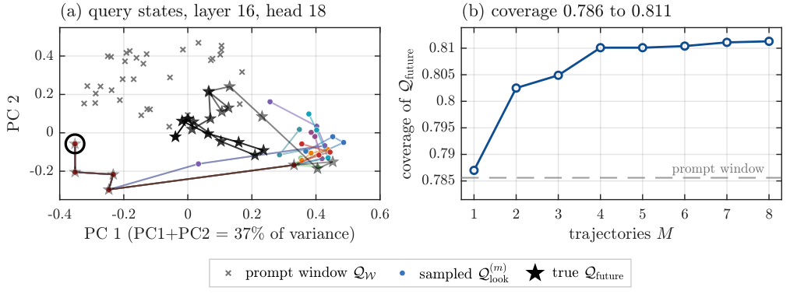</p>

**Accuracy under compression.** LORE-KV leads at every budget on RULER across context lengths (Fig. 3) and reaches
AnDPro's LongBench accuracy with 1.50-1.63x less cache (Fig. 2).

<p align="center">
  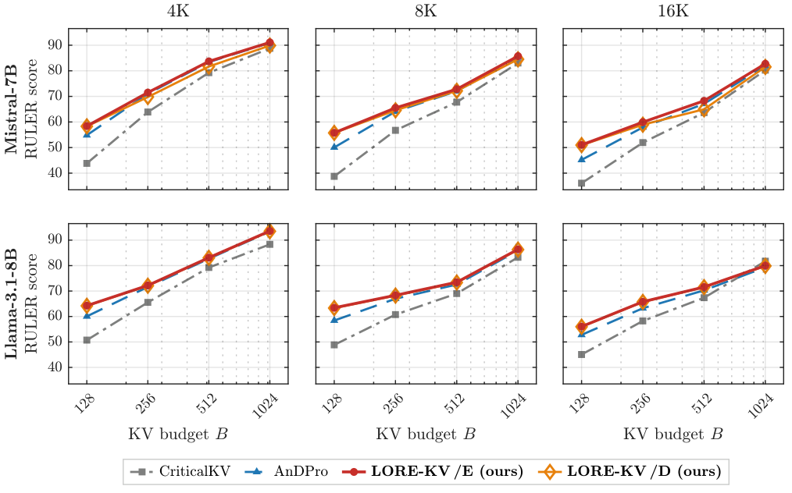
  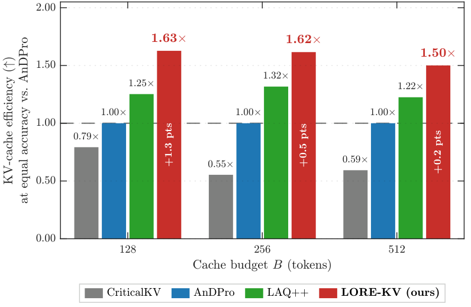
</p>

| LongBench avg., $B=128$ | Full cache | CriticalKV | AnDPro | LORE-KV /E | LORE-KV /D |
|---|---:|---:|---:|---:|---:|
| Mistral-7B-Instruct-v0.2 | 42.51 | 38.42 | 38.96 | **40.28** | 40.21 |
| Llama-3.1-8B-Instruct | 49.29 | 44.62 | 46.06 | 46.11 | **46.27** |
| Qwen2.5-14B-Instruct | 49.37 | 43.47 | 45.49 | 48.16 | **48.24** |
| Ministral-3-8B-Instruct-2512 | 49.67 | 44.79 | 46.74 | **47.30** | 47.24 |
| Qwen3.5-9B (hybrid) | 52.97 | 46.30 | 46.89 | 48.49 | **48.57** |
| Gemma-4-12B-it (hybrid) | 27.27 | 19.74 | 20.21 | 20.85 | **20.93** |

**Long context.** On RULER at 64K and 128K tokens (Llama-3.1-8B, $B=128$), the margin over AnDPro grows with
context length.

| RULER, 13-task avg. | CriticalKV | AnDPro | LORE-KV /E | LORE-KV /D |
|---|---:|---:|---:|---:|
| 64K | 34.82 | 49.62 | **57.75** | 57.29 |
| 128K | 30.28 | 39.40 | **51.05** | 51.04 |

<p align="center">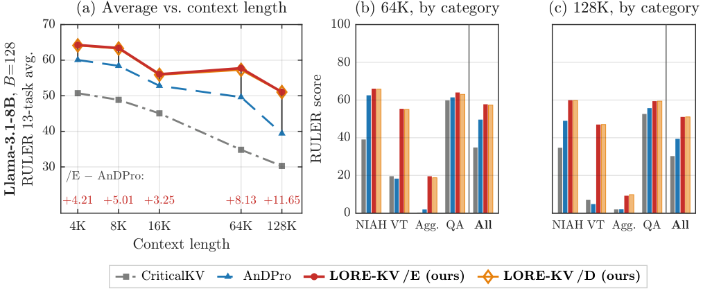</p>

**Where the gain comes from.** The gain grows with the mismatch between prompt-window and future queries (Fig. 6),
and the cache LORE-KV keeps reproduces the full-cache attention output more faithfully (Fig. 5).

<p align="center">
  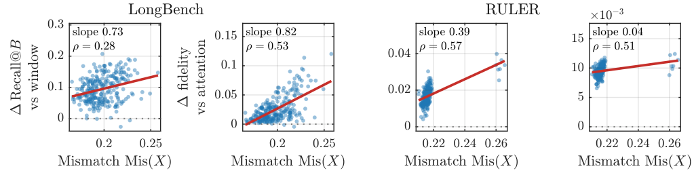
  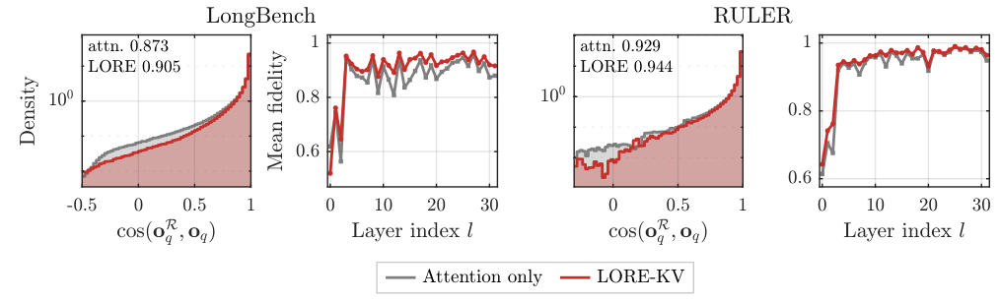
</p>

**Cost.** The lookahead is a one-time overhead per request; Fig. 7 splits latency by stage and plots quality against
total latency. Under a matched lookahead-token budget LORE-KV stays above AnDPro scoring the same continuations
(Table 13b).

<p align="center">
  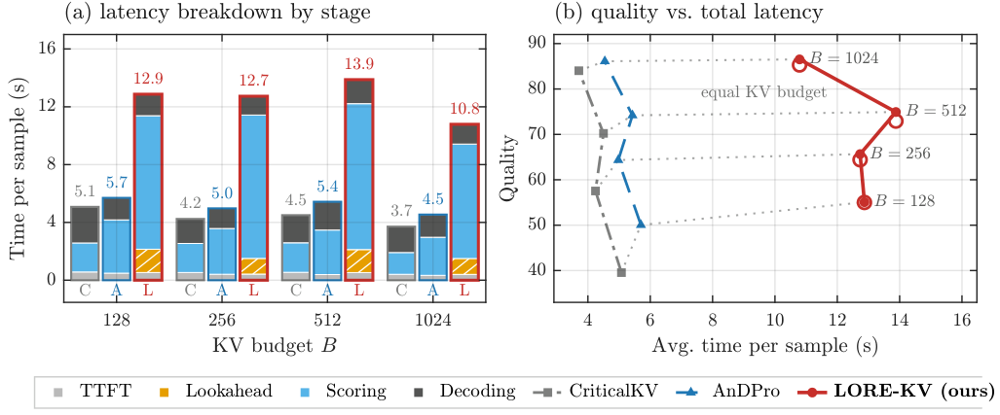
  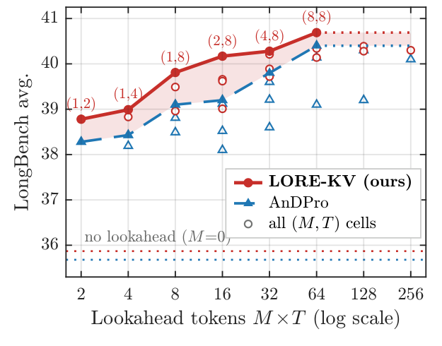
</p>

<details>
<summary>🔍 More analyses: NIAH, accuracy-memory trade-off, retention shift, criterion comparison, token classes, layers and heads, budget equivalence</summary>

<p align="center">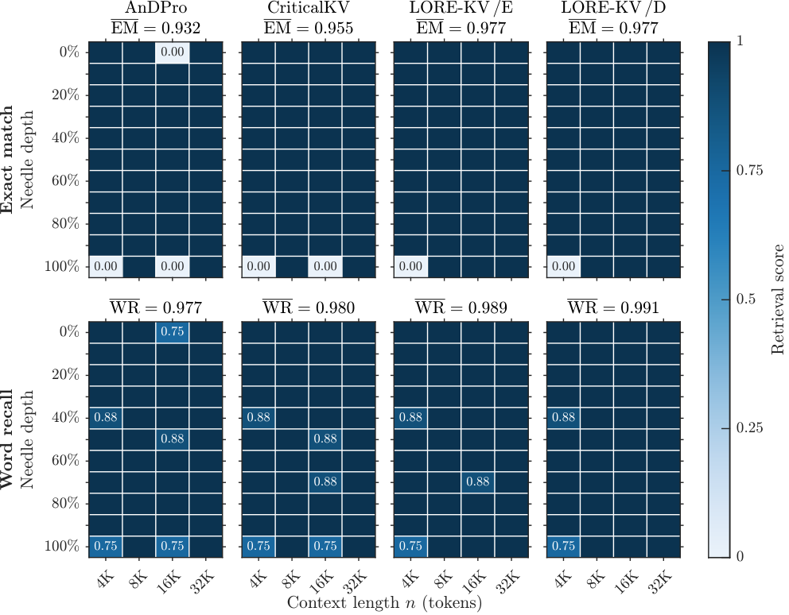</p>
<p align="center">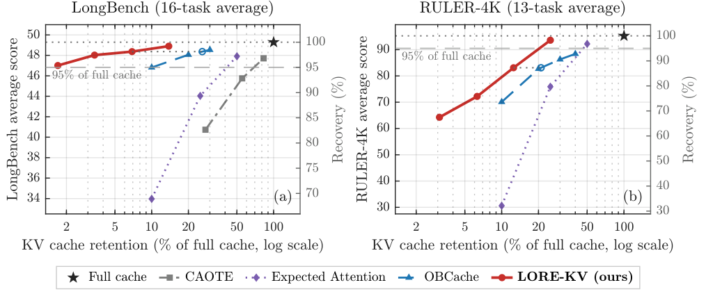</p>
<p align="center">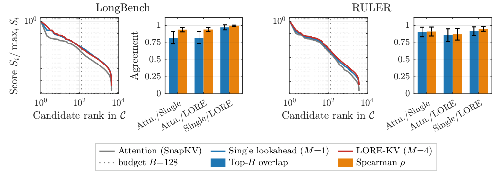</p>
<p align="center">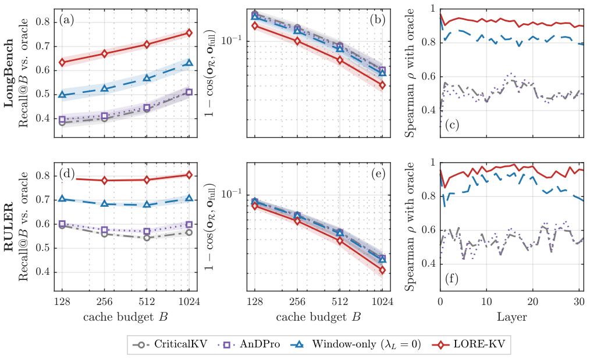</p>
<p align="center">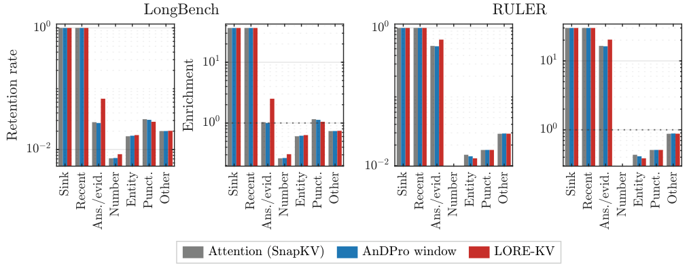</p>
<p align="center">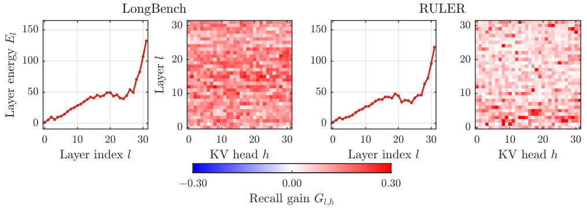</p>
<p align="center">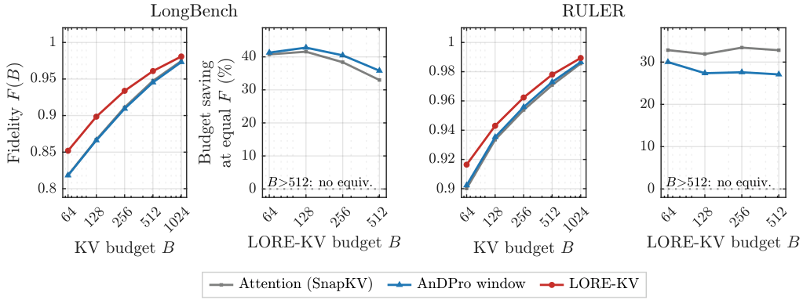</p>

</details>

## ⚙️ Installation

Two environments are used: transformers 4.44 for the dense backbones and transformers 5.x for the
hybrid-attention ones. Both need an NVIDIA GPU with compute capability 8.0 or 9.0 (A100, H100) and CUDA 12.

```bash
git clone <repository-url> lorekv && cd lorekv

# Dense backbones: Mistral-7B, Llama-3.1-8B, Qwen2.5-14B, Ministral-3-8B
uv venv --python 3.11 .venv && source .venv/bin/activate
uv sync                       # or: uv pip install -e . --no-build-isolation
make install                  # builds the varlen KV-cache CUDA kernel in csrc/
make test                     # CPU unit tests of the estimator and scoring

# Hybrid backbones: Qwen3.5-9B, Gemma-4-12B-it (separate environment)
uv venv --python 3.11 .venv-hybrid && source .venv-hybrid/bin/activate
uv pip install -r requirements-hybrid.txt && make install
```

Machine-specific paths (Hugging Face cache, a virtual environment to activate in batch jobs, environment
modules) go in `.env`; copy `.env.example`. Llama-3.1 is gated on the Hub: run `huggingface-cli login`.

**Local checkpoints.** The Qwen2.5-14B, Ministral-3-8B, Qwen3.5-9B and Gemma-4-12B configs read
`models/<name>`:

```bash
python scripts/prepare_local_checkpoint.py --src Qwen/Qwen2.5-14B-Instruct --out models/Qwen2.5-14B-Instruct
python scripts/convert_ministral3.py --src mistralai/Ministral-3-8B-Instruct-2512 \
    --out models/Ministral-3-8B-Instruct-2512      # text tower of the vision-language release
```

For the hybrid backbones, download the checkpoints into `models/Qwen3.5-9B` and `models/gemma-4-12B-it`.

## 🚀 Quick start

Every experiment is one config on one benchmark. The sweep driver expands the config's value lists, calls
the benchmark's `pred.py` once per setting and scores the results:

```bash
# LORE-KV /E on LongBench with Mistral-7B, budgets 128-1024
python scripts/sweep.py --benchmark LongBench --config config/lorekv-ent-unif-topk.conf

# Same, as a SLURM job (extra sbatch options via SBATCH_ARGS)
bash scripts/submit.sh lorekv-ent-unif-topk
EXPERIMENT=RULER bash scripts/submit.sh lorekv-ent-unif-topk

# Any config key can be overridden from the environment
BUDGET=128 NUM_PARTICLES="1 2 4 8" python scripts/sweep.py --benchmark LongBench \
    --config config/lorekv-ent-unif-topk.conf

# Print the commands without running them
python scripts/sweep.py --benchmark NIAH --config config/andpro-llama.conf --dry-run
```

Predictions go to `experiments/<benchmark>/pred/<run>/` and scores to `result.json` in the same folder. An
interrupted run resumes: finished datasets are skipped, and RULER resumes row by row.

**Using LORE-KV in your own code.**

```python
import argparse

from lorekv.harness import add_method_args, configure_model, install_method, load_model_and_tokenizer
from lorekv.monkeypatch.lookahead_runner import generate_with_lookahead

args = add_method_args(argparse.ArgumentParser()).parse_args(["--budget", "128"])  # LORE-KV /E defaults
install_method(args.mode)                        # patch before the model is built
model, tok = load_model_and_tokenizer("mistralai/Mistral-7B-Instruct-v0.2")
configure_model(model, args)

inputs = tok(long_prompt, return_tensors="pt").to("cuda:0")
answer_ids = generate_with_lookahead(model, tok, inputs.input_ids, inputs.attention_mask,
                                     max_gen=128, eos_token_ids=[tok.eos_token_id])
print(tok.decode(answer_ids, skip_special_tokens=True))
```

`--mode` also accepts the baselines: `andpro`, `critical`, `ada` (Ada-KV), `fix` (SnapKV; add `--pyram` for
PyramidKV), `slm` (StreamingLLM) and `full` (uncompressed).

## 🔁 Reproducing the paper

### 🧪 Benchmarks

| Benchmark | Data | Metric |
|---|---|---|
| LongBench, 16 English tasks | `THUDM/LongBench` from the Hub | task metrics of Table 5 |
| RULER 4K / 8K / 16K, 13 tasks | `simonjegou/ruler` from the Hub | `string_match_all` / `string_match_part` |
| RULER 64K / 128K | generated by `bash experiments/RULER/long_context/make_data.sh` | as above |
| Needle-in-a-Haystack | Paul Graham essays in `experiments/NIAH/PaulGrahamEssays` | exact match, word recall |

### 📋 Main results

Each table is the listed configs on the listed benchmark (`EXPERIMENT=LongBench | RULER | NIAH`).

| Paper | Backbone | Configs |
|---|---|---|
| Table 1, Fig. 2 | Mistral-7B-Instruct-v0.2 | `lorekv-ent-unif-topk`, `lorekv-dis-unif-topk`, `andpro`, `critical`, `fullcache` |
| Table 6 | Llama-3.1-8B-Instruct | the same configs with `-llama` |
| Table 11 | Qwen2.5-14B-Instruct | the same configs with `-qwen2` |
| Table 12 | Ministral-3-8B-Instruct-2512 | the same configs with `-ministral3` |
| Tables 2, 8, 9 | Qwen3.5-9B, Gemma-4-12B-it | the same configs with `-qwen35`, `-gemma4` (hybrid environment) |
| Fig. 3, Tables 7, 10 | Mistral, Llama | the Mistral and Llama configs with `EXPERIMENT=RULER` |
| RULER 64K / 128K | Llama-3.1-8B | the `-llama` configs with `DATASET_NAME_LIST="65536 131072"` |
| Fig. 8 | Llama-3.1-8B | the `-llama` configs with `EXPERIMENT=NIAH BUDGET=1024` |

### 🔬 Ablations (Mistral-7B, Tables 13-15)

| Ablation | How to run |
|---|---|
| Lookahead budget $M$ (Table 14) | `NUM_PARTICLES="0 1 2 4 8"` with `lorekv-ent-unif-topk` |
| Geometry $M\times T$ (Table 13a) | `NUM_PARTICLES="1 2 4 8" LOOKAHEAD_LEN="2 4 8 16 32" BUDGET=128` |
| Matched lookahead-token budget (Table 13b) | `andpro-compute-eq` with the same sweep |
| Reliability weighting | `lorekv-logp-unif-topk`, `lorekv-ent-dis-unif-topk` |
| Deletion objective | `lorekv-obj-attn`, `lorekv-obj-unproj`, `andpro-compute-eq` |
| Adaptive budgets / diversity | `lorekv-{ent,dis,logp}-adap-topk`, `lorekv-{ent,dis,logp}-adap-div` |
| Robust aggregation | `ROBUST_ALPHA=0.5 ROBUST_TOPK_BETA=0.5` with `lorekv-ent-unif-topk` |

### 📈 Tables, latency and figures

```bash
python scripts/collect_results.py --benchmark LongBench --plot    # every run -> CSV (+ PNG)
python scripts/longbench_table.py --backbone qwen2                 # LaTeX rows of Table 11
python scripts/longbench_ablations.py                              # Tables 13a and 14
python scripts/report_length_time.py                               # per-sample latency, Table 3
cd experiments/LongBench && python ../../scripts/profile_latency_breakdown.py   # stage latency, Fig. 7
```

The mechanism analyses (App. F) capture the prompt-window, lookahead and true answer-time queries with the
deployed code and compare criteria under one shared selector. Each needs one GPU:

```bash
CONFIG_FILE=config/lorekv-ent-unif-topk.conf bash scripts/run_figures.sh   # LongBench single-doc QA
BENCHMARK=ruler DATASET=4096 bash scripts/run_figures.sh                   # RULER 4K
bash scripts/run_demo_token_ranking.sh && python scripts/plot_token_ranking_demo.py
python scripts/demo_montecarlo_queries.py --benchmark ruler --dataset 4096 && python scripts/plot_montecarlo_demo.py
```

| Paper figure | Code |
|---|---|
| Fig. 1, Monte Carlo future-query estimation | `scripts/demo_montecarlo_queries.py`, `scripts/plot_montecarlo_demo.py`; coverage curves in `fig1_future_query_alignment` |
| Fig. 5, attention-output fidelity | `fig3_cache_distribution` |
| Fig. 6, gain vs. query mismatch | `fig6_mismatch_vs_gain` |
| Fig. 7, latency-quality trade-off | `scripts/profile_latency_breakdown.py`, `scripts/report_length_time.py` |
| Fig. 9, retention-order shift | `fig2_score_comparison` |
| Fig. 10, criterion comparison | `scripts/demo_token_ranking.py`, `scripts/plot_token_ranking_demo.py` |
| Fig. 11, retention by token class | `fig7_retained_token_composition` |
| Fig. 12, layer and head structure | `fig8_layer_head_analysis` |
| Fig. 13, budget equivalence | `fig9_budget_equivalence` |
| App. F.4, reliability signals | `fig4_entropy_trajectory`, `fig5_confidence_calibration`, `fig10_particle_divergence` |

Figure folders live in `experiments/LongBench/figure_making_script/`; the RULER folders are thin wrappers
around the same code. Each has a `compute_*.py` (GPU, writes a `.npz`) and a `plot_*.py` (CPU, draws the
`.png`); `PLOT_ONLY=1 bash scripts/run_figures.sh` redraws from saved data.

## 🗂️ Repository layout

```
lorekv/                       the method
  harness.py                  method selection, configuration, model loading (shared by all drivers)
  data.py                     LongBench and RULER loaders
  monkeypatch/
    scoring.py                reliability weights, deletion scores, selection, per-head cache
    lookahead_runner.py       generation for one prompt (Algorithm 1)
    causal_*_hijack.py        phase-aware attention and model forwards per backbone
    *hybrid*.py               Qwen3.5 / Gemma 4 support
andpro_snapkv/                AnDPro baseline
adaptive_snapkv/              SnapKV, PyramidKV, Ada-KV, StreamingLLM baselines (also `critical`)
models_ext/                   Ministral-3 for transformers 4.44
csrc/                         CUDA kernel for the ragged per-head cache
experiments/
  LongBench/ RULER/ NIAH/     pred.py (decode) and eval.py (score) per benchmark
  */figure_making_script/     mechanism-analysis figures (App. F)
config/                       one .conf per configuration in the paper
scripts/                      sweep driver, launchers, tables, latency, analyses, checks
tests/                        CPU unit tests
assets/                       README and project-page figures (scripts/make_readme_assets.py)
website/                      project page (index.html)
```

## ⚠️ Limitations

LORE-KV adds a one-time lookahead and scoring overhead to every request (Table 3), makes irreversible
eviction decisions, and does not model cross-head or cross-layer interactions. Its gains shrink at large
budgets and coexist with task-level regressions. On hybrid backbones the per-trajectory cache copy can
exceed device memory at very long context.

## 📚 Citation

```bibtex
@inproceedings{lorekv2027,
  title     = {Monte Carlo Estimation for {KV} Cache Eviction},
  author    = {Anonymous},
  booktitle = {Under review at the International Conference on Learning Representations},
  year      = {2027}
}
```

## 🙏 Acknowledgements

This code builds on [LLM-AnDPro](https://github.com/MIRALab-USTC/LLM-AnDPro) (Geng et al., NeurIPS 2025)
and [AdaKV](https://github.com/FFY0/AdaKV) (Feng et al.), which include code from
[SnapKV](https://github.com/FasterDecoding/SnapKV) and [PyramidKV](https://github.com/Zefan-Cai/PyramidKV).
Evaluation code is adapted from [LongBench](https://github.com/THUDM/LongBench),
[RULER](https://github.com/NVIDIA/RULER) and
[LLMTest_NeedleInAHaystack](https://github.com/gkamradt/LLMTest_NeedleInAHaystack); model code adapts
[Hugging Face Transformers](https://github.com/huggingface/transformers). We thank the authors for
releasing their work.

## 📄 License

MIT; see [LICENSE](LICENSE). Adapted components keep their original licenses (MIT, or Apache-2.0 for code
derived from Transformers and RULER).
